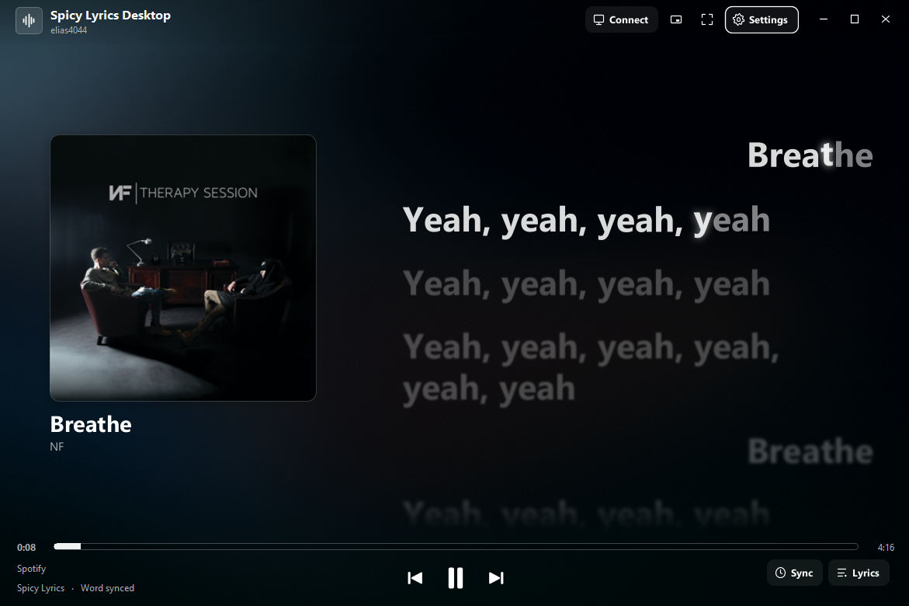

# Spicy Lyrics Desktop

Spicy Lyrics Desktop brings synced lyrics to Windows. It follows the music already playing in Spotify, a browser, or another Windows media app. You can also play local audio and import TTML, LRC, or plain-text lyrics.

Unlike the Spicetify extentsion Spicy Lyrics, this runs nearly natively which means a lot better performance and supports almost all music platforms — while supporting more sources for grabbing lyrics, which means, from my testing, almost every song being word synced or at least synced. 

The app adapts the lyrics engine and renderer from [Spicy Lyrics Mobile](https://github.com/spicylyrics/mobile) at revision [f005aaa](https://github.com/spicylyrics/mobile/tree/f005aaa33a51d1fedfab8af15fce9f929dc41407).



## Install on Windows

Download `SpicyLyrics-<version>.msi` from [GitHub Releases](https://github.com/elias4044/spicy-lyrics-desktop/releases), then run it and open **SpicyLyrics** from Start. The per-user installer includes Java and the Windows media bridge. It supports x64 Windows 10 (1809 or later) and Windows 11. You can uninstall it from Windows Settings under **Apps**. Release installers are unsigned and come with a SHA-256 checksum.

You can also run the portable build by opening `SpicyLyrics.exe` inside the `SpicyLyrics` folder. Keep the `app` and `runtime` folders beside it. Choose **Connect → Try the lyrics demo** to preview the app without a music service.

## Connect a music source

| Connection | How to use it |
| --- | --- |
| Windows media | Start a song in an app that publishes Windows media metadata. Use **Connect → Choose a Windows media session** to pin a specific player. Timing and controls depend on the selected app. |
| Local files | Open or drop audio files. Multiple files play as a queue. Matching TTML, LRC, and TXT sidecar files load automatically. |
| Browser tab | Load the included `browser-companion` folder as an unpacked extension in Chrome or Edge. Choose **Connect → Connect a browser tab**, then enter the pairing code in the extension on the music tab. Works with sites that use a finite HTML audio or video element. |
| Manual timing | Enter a title and artist, then play alongside your music source. Adjust the clock with the timeline or arrow keys. |

Click a timed lyric to seek to it. Plain lyrics scroll with playback when the track duration is available. **Up Next** previews the next local queue track. The **Sync** menu adjusts the current song's offset, and **Settings → Lyrics & sync** sets a global offset.

| Shortcut | Action |
| --- | --- |
| Space | Play or pause |
| Left / Right | Seek five seconds |
| F11 / Esc | Enter or leave fullscreen |
| Ctrl+M | Toggle mini lyrics |
| Ctrl+O | Open audio files |
| Ctrl+L | Toggle the cover view |
| Ctrl+, | Open Settings |

## Lyrics and privacy

The app supports the mobile port's 14 playback provider adapters, including Spicy Lyrics, AMLL TTML DB, Unison, lrc.red, LRCLIB, LRCMux, RMM Revival, Kugou, QQ Music, Kuwo, NetEase, Genius, and YouTube transcripts. Use **Settings → Sources** to choose providers or add your Spicy Lyrics publishable key. Advanced lookup diagnostics show source outcomes for the current track.

Enabled providers can receive song metadata during lookups. Optional translation sends the text to the selected translation provider. Local lyrics, settings, and caches are stored under `%LOCALAPPDATA%\Spicy Lyrics for Windows`. Settings exports omit API keys and custom header values.

## Build and test

Install JDK 17 and Visual Studio 2022 or Build Tools with **Desktop development with C++** and a Windows SDK with C++/WinRT headers. For the MSI, add [WiX Toolset 3.14.1](https://github.com/wixtoolset/wix3/releases/tag/wix3141rtm) to `PATH` or pass `-WixBin` with the directory containing `candle.exe` and `light.exe`.

```powershell
.\scripts\build-native.ps1
.\gradlew.bat :desktop:run
.\gradlew.bat :core:test
.\scripts\package-windows.ps1
```

Packaging reports each build step and writes the portable app, MSI, and checksum to `desktop/build/package`. The MSI shows installation progress and adds a **Spicy Lyrics Desktop** group to the Windows Start menu. Pass `-Verbose` for detailed packaging output, `-SkipTests` to skip the core tests, `-PortableOnly` to skip the MSI, or `-Version 1.2.3` to set the package version. Use a fresh `-OutputDirectory` for repeat builds. GitHub Actions tests Windows builds and prepares a draft release with the installer for version tags such as `v0.1.0`.

- `desktop` contains the Kotlin player, settings, and Java2D renderer.
- `core` contains the Kotlin lyrics engine, provider adapters, parsers, and tests.
- `native` contains the C++/WinRT media bridge.
- `browser-companion` contains the optional browser extension.

The desktop build requires no Android SDK or separate Android checkout. Spring is the default renderer. Bloom, lyric sizing, and local font files are available under **Settings → Lyrics**.

## Contribute

See [Contributing](CONTRIBUTING.md) for development and pull requests. Report regular bugs in [Issues](https://github.com/elias4044/spicy-lyrics-desktop/issues) and security issues through the [security policy](SECURITY.md).

The application is licensed under the [GNU Affero General Public License v3](LICENSE). See [Third-party notices](THIRD_PARTY_NOTICES.md) for upstream credits and bundled dependencies.
